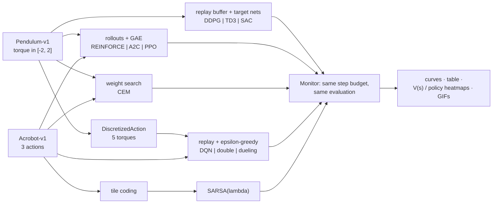
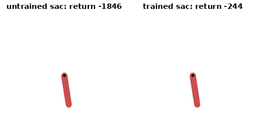
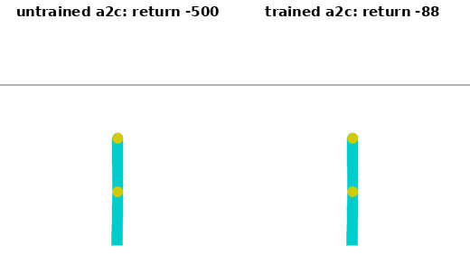
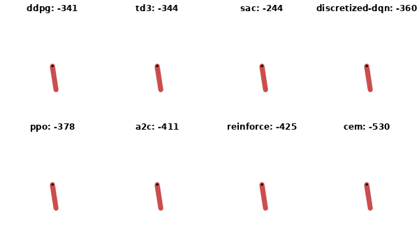
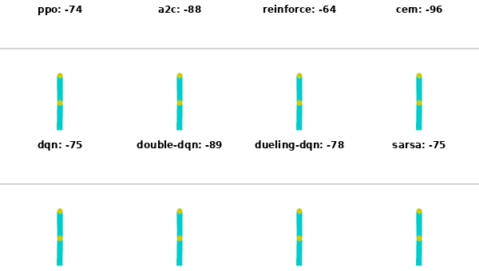

# pendulum-rl

**Pendulum swing-up (continuous torque) and Acrobot (discrete actions) solved with every
classic RL method in one small, readable PyTorch code base: DDPG, TD3, SAC with automatic
entropy tuning, PPO with GAE and clipping, A2C, REINFORCE, the cross-entropy method, DQN /
double / dueling / discretized DQN and tile-coded SARSA(lambda). Every method uses the same
environment, the same evaluation, the same plots, trains in minutes on one CPU thread, and
is explained step by step in the docs and a Kaggle/Colab notebook.**

[](LICENSE)
[](pyproject.toml)
[](https://pytorch.org)
[](https://gymnasium.farama.org)
[](docs/testing.md)

The goal is to *see* how each method works: one file per family, the equations next to
the code, the same budget unit (environment steps) for everyone, and figures that show
what each agent learned, not only its score.



## Before and after training

The same start state (hanging down, nearly still, the hardest one), the same network:
left freshly initialised, right after training. The caption is the episode return.

**Pendulum, SAC** (15 000 training steps, 1.8 min on one CPU thread): the untrained actor
never gets the rod upright (return -1846); the trained one rocks it to gain energy, then
brakes and holds it upright (-244).



**Acrobot, A2C** (the best final return of the eight Acrobot methods): the untrained policy
never reaches the line in 500 steps; the trained one swings the tip over it in 88 steps.



Every method, the same hanging start (Pendulum) and the same Acrobot start. From this start,
about -250 is the best a swing-up can score:





`python scripts/make_gifs.py` regenerates all four from the checkpoints in `runs/`.

| method | `--algo` | env | how it works, in one line | code |
|---|---|---|---|---|
| DDPG | `ddpg` | Pendulum | deterministic actor `mu(s)` climbs the critic `Q(s, mu(s))`; Gaussian action noise explores | `algorithms/ddpg.py` |
| TD3 | `td3` | Pendulum | DDPG + min of twin critics, delayed actor updates, noise on the target action | `algorithms/td3.py` |
| SAC | `sac` | Pendulum | stochastic tanh-Gaussian actor maximising reward + alpha x entropy; alpha tuned automatically | `algorithms/sac.py` |
| PPO | `ppo` | both | rollouts of 2048 steps, GAE, 10 epochs on the clipped ratio `min(rho A, clip(rho) A)` | `algorithms/policy_gradient.py: PPO` |
| A2C | `a2c` | both | learned V(s), GAE over short rollouts, one gradient step per rollout | `algorithms/policy_gradient.py: A2C` |
| REINFORCE | `reinforce` | both | `log pi(a|s)` x normalised Monte Carlo return of whole episodes, no critic | `algorithms/policy_gradient.py: Reinforce` |
| cross-entropy method | `cem` | both | sample 50 weight vectors, keep the best 20%, refit the Gaussian; no gradient at all | `algorithms/cem.py` |
| discretized DQN | `discretized-dqn` | Pendulum | the torque cut into 5 values, then double DQN | `envs.DiscretizedAction` + `algorithms/dqn.py` |
| DQN | `dqn` | Acrobot | epsilon-greedy, replay, target net, `y = r + gamma max Q'(s', .)` | `algorithms/dqn.py` |
| double DQN | `double-dqn` | Acrobot | online net picks `argmax`, target net evaluates it: less overestimation | `algorithms/dqn.py` |
| dueling DQN | `dueling-dqn` | Acrobot | `Q = V(s) + A(s, a) - mean A`, double-DQN target | `networks.DuelingQNetwork` |
| SARSA(lambda) | `sarsa` | Acrobot | linear Q over 8 shifted tile grids, eligibility traces, optimistic init | `algorithms/sarsa.py` |

Each one is explained with its equations, the plain-words "why" and the code in
[docs/architecture.md](docs/architecture.md).

## Quick start

```bash
git clone https://github.com/benisalla/pendulum-rl && cd pendulum-rl
uv venv .venv && VIRTUAL_ENV=.venv uv pip install -e ".[dev]"     # or: pip install -e ".[dev]"
source .venv/bin/activate

pendulum-train --env pendulum --algo sac                       # 15k steps, saves runs/pendulum/sac/
pendulum-eval runs/pendulum/sac/model.pt --episodes 20         # mean return of the deterministic policy
pendulum-play runs/pendulum/sac/model.pt --gif sac.gif         # headless GIF (SDL dummy driver)
pendulum-train --env acrobot --algo dueling-dqn
pendulum-compare --env pendulum --train                        # every method, table + curves + heatmaps
```

`uv` installs the CPU build of PyTorch (configured in `pyproject.toml`); plain `pip` uses
the default wheel. Every `TrainConfig` field is a flag (`--total-steps`, `--lr`,
`--gamma`, `--n-bins`, `--sarsa-lambda`, ...); see [docs/training.md](docs/training.md).

## Examples

[`examples/`](examples/README.md) holds six short scripts that use the package from
Python, in order: train SAC in 6 000 steps, evaluate it and draw its value / torque
heatmaps and a GIF, take PPO apart (one rollout, GAE, how often the ratio is clipped),
solve Acrobot without a neural network (tile-coded SARSA and CEM), train **any method in
one command** with small defaults, and compare everything you ran.

```bash
python examples/01_train_sac_pendulum.py && python examples/02_evaluate_heatmap_gif.py
python examples/05_train_any_method.py --algo td3          # or --env acrobot --algo dueling-dqn
```

## Results

These are **short, single-seed CPU runs** (seed 0, one thread, a shared machine). They
show that every method learns and how fast it learns. They are not benchmarks.
Protocol: the deterministic policy, 20 final episodes from the same start states for
every method, and "steps to reach" = first evaluation (5 episodes) at the threshold.
All 16 runs together take 31 minutes of training. Details, the reasoning behind each
result, and an honest log of the fixes made after the first full run are in
[docs/evaluation.md](docs/evaluation.md).

### Pendulum-v1: random policy about -1200, solved at -200

| method | env steps | steps to reach -200 | final return (20 episodes) | wall time |
|---|---|---|---|---|
| `sac` | 15,000 | 6,000 | **-119.0** ± 82.5 | 1.8 min |
| `ddpg` | 15,000 | 5,000 | -121.1 ± 83.1 | 3.2 min |
| `discretized-dqn` | 30,000 | 12,000 | -121.5 ± 82.7 | 1.1 min |
| `td3` | 15,000 | 6,000 | -123.1 ± 85.0 | 3.2 min |
| `ppo` | 100,000 | 20,000 | -125.0 ± 86.8 | 1.4 min |
| `reinforce` | 600,000 | 320,000 | -149.2 ± 99.4 | 2.8 min |
| `cem` | 1,500,000 | 1,400,000 | -175.5 ± 116.2 | 1.7 min |
| `a2c` | 150,000 | 55,000 | -188.0 ± 196.9 | 1.6 min |


What the table shows:
- **Off-policy methods solve it fastest.** DDPG, TD3 and SAC solve it in 5-6k steps because the replay buffer reuses every transition.
- **Five torques are enough for DQN.** With the action discretized into 5 values it reaches the same final return.
- **PPO** needs 4x the steps of SAC but about the same wall time.
- **REINFORCE and CEM** need 40x and 230x the steps of SAC (600k and 1.4M against 6k).
- **A2C** is the least stable: a few start states end in failed swing-ups.
- **The ± ~85 is the start state**, not the policy: a good episode from near the top scores about 0, and from hanging still about -250.

**What they learned.** The top row shows V(s) over (theta, theta_dot), with theta = 0 upright. The bottom row shows the torque. Every critic finds the same diagonal band of states that coast to the top. Every policy is nearly bang-bang: pump energy with the motion, brake on the band.


### Acrobot-v1: random policy -500, solved at -100

| method | env steps | steps to reach -100 | final return (20 episodes) | wall time |
|---|---|---|---|---|
| `a2c` | 150,000 | 40,000 | **-80.5** ± 13.3 | 1.5 min |
| `dqn` | 60,000 | 27,500 | -84.7 ± 14.3 | 2.9 min |
| `cem` | 150,000 | 80,000 | -85.2 ± 26.1 | 0.3 min |
| `dueling-dqn` | 60,000 | 17,500 | -85.7 ± 12.8 | 2.7 min |
| `reinforce` | 100,000 | 25,000 | -86.6 ± 37.6 | 0.7 min |
| `ppo` | 150,000 | 25,000 | -87.1 ± 34.3 | 3.1 min |
| `sarsa` | 50,000 | **12,500** | -96.2 ± 33.3 | 0.2 min |
| `double-dqn` | 60,000 | 20,000 | -108.0 ± 91.5 | 2.3 min |


What the table shows:
- **Tile-coded SARSA(lambda) is the fastest to the threshold**, with no neural network: 12 500 steps in 12 seconds.
- **Every method reached -100 during training.**
- **Double DQN's final mean misses the threshold.** Its best evaluation was -72, but one or two of its 20 final episodes stall at the bottom.
- **Some first-run settings did not hold up.** The first full run left DQN's greedy policy unstable, REINFORCE stuck at -500 on Acrobot, PPO collapsing late on Pendulum and CEM stalling. The causes and fixes are in the [fix log](docs/evaluation.md#fixes-made-after-the-first-full-run-honest-log).

## Train for real: Kaggle / Colab notebook

[`notebooks/train_colab_kaggle.ipynb`](notebooks/train_colab_kaggle.ipynb) is generated from
`src/pendulum_rl` by `notebooks/build_notebook.py`: each section explains one idea
(continuous actions, deterministic vs stochastic policies, DDPG's actor-critic, TD3's three
fixes, SAC's entropy objective, PPO's clipping and GAE, CEM, DQN variants, tile-coded
SARSA), shows the exact code of the method, trains it, and ends with the full comparison,
heatmaps and GIFs. CPU runtime is enough (and fastest) for networks this small.

## Repository layout

```
src/pendulum_rl/
  config.py        TrainConfig (every hyperparameter = a CLI flag), tuned DEFAULTS per (env, algo)
  envs.py          Pendulum-v1 / Acrobot-v1, DiscretizedAction wrapper
  networks.py      actors, critics, twin critics, Gaussian / categorical policies, Q / dueling nets
  buffers.py       replay buffer (terminated vs truncated), GAE
  algorithms/      base (shared off-policy loop), ddpg, td3, sac, dqn, policy_gradient, cem, sarsa
  registry.py      name -> agent class, checkpoint save / load
  metrics.py       Monitor (step budget + periodic evaluation), results table
  train.py         train(), `pendulum-train`
  evaluate.py      evaluate(), `pendulum-eval`
  play.py          `pendulum-play` (+ GIF)
  compare.py       `pendulum-compare`: train all, table, curves, heatmaps
  viz.py           return curves, value / policy heatmaps, GIFs
docs/              architecture, environment, training, evaluation, testing
examples/          six scripts, from one training run to the full comparison
tests/             40 fast tests (+1 opt-in slow learning test)
notebooks/         build_notebook.py -> train_colab_kaggle.ipynb
scripts/          run_all.sh (every real run behind the tables), make_gifs.py (before/after + grid GIFs)
assets/            the figures and tables of the Results section
```

## Documentation

- [docs/architecture.md](docs/architecture.md): every method, its equations, why it works, where the code is
- [docs/environment.md](docs/environment.md): Pendulum and Acrobot, terminated vs truncated, discretization, rendering
- [docs/training.md](docs/training.md): the shared loop, defaults and why, budgets, threads, seeds
- [docs/evaluation.md](docs/evaluation.md): the evaluation protocol and the runs behind the results
- [docs/testing.md](docs/testing.md): what the tests check
- [examples/](examples/README.md): the package from Python, step by step

## Legacy notebooks

None: this repository was written fresh, there is no earlier notebook for Pendulum or
Acrobot. The CartPole coursework notebooks live in their own repository.

## References

Lillicrap et al. 2016 (DDPG) · Fujimoto et al. 2018 (TD3) · Haarnoja et al. 2018 (SAC and
automatic temperature) · Schulman et al. 2016 (GAE), 2017 (PPO) · Mnih et al. 2015 (DQN),
2016 (A3C/A2C) · van Hasselt et al. 2016 (double DQN) · Wang et al. 2016 (dueling) ·
Williams 1992 (REINFORCE) · Rubinstein 1999, Szita & Lorincz 2006 (CEM) · Sutton & Barto
2018, ch. 10 and 12 (tile coding, SARSA(lambda), Acrobot).

## License

MIT, (c) 2026 Ismail Ben Alla
