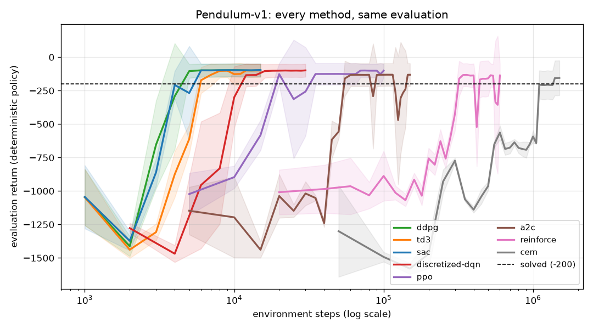
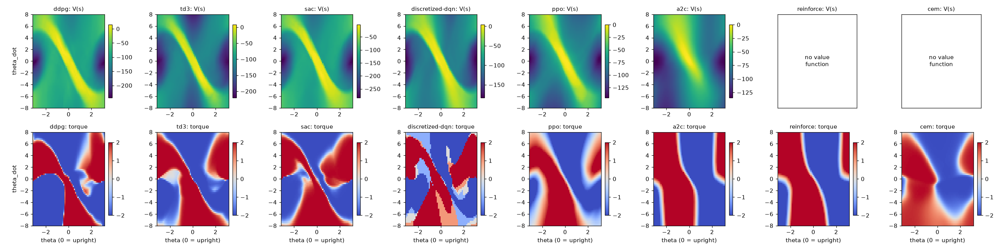
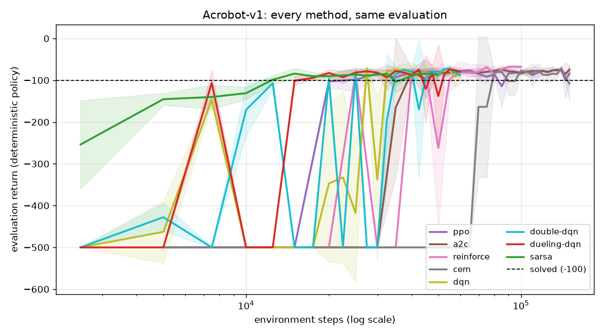

# Evaluation and the runs behind the results

## Protocol (the same for every method)

- **Policy evaluated:** the deterministic one: `mu(s)` for DDPG/TD3, the mean action
  `2 tanh(mu(s))` for SAC, the Gaussian mean for PPO/A2C/REINFORCE, the CEM mean weights,
  greedy `argmax Q` for the DQN family and SARSA. No exploration noise.
- **Start states:** environment seeds 10 000, 10 001, ... These are the same for every
  method and separate from the training seed (0).
- **During training:** 5 episodes every `eval_every` steps (the curves; the band is ± 1 std).
- **Final:** 20 episodes after training (the table's "final return").
- **Steps to reach:** the first evaluation step at which the 5-episode mean reached the
  threshold (-200 for Pendulum, -100 for Acrobot).
- **Wall time:** training only, one CPU thread, on a shared 8-core machine with many other
  jobs running. Treat the times as rough and compare them only with each other.

`pendulum-eval runs/<env>/<algo>/model.pt --episodes 20` reproduces a final number.

## How to reproduce

```bash
bash scripts/run_all.sh          # every run below, one at a time (~31 min of training on one thread)
python scripts/make_gifs.py      # the before/after GIFs and GIF grids of the README
```

Seed 0 for everything, defaults from `pendulum_rl.config.DEFAULTS`. These are **single-seed,
short CPU runs**: they show that each method learns and how fast. They are not benchmarks.
A different seed can change the ranking of methods whose results are close.

## Pendulum-v1 (random policy about -1200, solved at -200)

| method | env steps | steps to reach -200 | final return (20 episodes) | best eval | wall time |
|---|---|---|---|---|---|
| `sac` | 15,000 | 6,000 | -119.0 ± 82.5 | -95.8 | 1.8 min |
| `ddpg` | 15,000 | 5,000 | -121.1 ± 83.1 | -96.8 | 3.2 min |
| `discretized-dqn` | 30,000 | 12,000 | -121.5 ± 82.7 | -98.5 | 1.1 min |
| `td3` | 15,000 | 6,000 | -123.1 ± 85.0 | -98.9 | 3.2 min |
| `ppo` | 100,000 | 20,000 | -125.0 ± 86.8 | -99.4 | 1.4 min |
| `reinforce` | 600,000 | 320,000 | -149.2 ± 99.4 | -132.1 | 2.8 min |
| `cem` | 1,500,000 | 1,400,000 | -175.5 ± 116.2 | -155.0 | 1.7 min |
| `a2c` | 150,000 | 55,000 | -188.0 ± 196.9 | -130.7 | 1.6 min |



What the numbers say:

- **The three off-policy actor-critics solve Pendulum in 5-6k steps** (25-30 episodes). They
  reuse every transition many times from the replay buffer. TD3 and SAC are not better than
  DDPG here: Pendulum is too easy to show DDPG's overestimation problem. TD3 is slightly
  slower to start because of the delayed actor.
- **Five torques are enough.** Discretized double DQN reaches the same final return,
  needing about twice the steps.
- **PPO** needs about 4x more steps than SAC, but its updates are cheap, so the wall time is
  similar. **A2C** gets there but is the least stable method: its curve dips several times,
  and the final 20-episode mean is pulled down by a few episodes that fail to swing up
  (std 197).
- **REINFORCE** (no critic) needs 320k steps and is still improving at 600k.
- **CEM** needs 1.4M steps (47 generations of 150 episodes), but those steps take under
  2 minutes because there is no gradient.
- The ± 80-100 std of the good methods is not noise in the policy. It comes from the start
  states: from a start near the top a good episode scores about 0, and from hanging still
  it scores about -250. That is also why the GIF grid of the README (hanging start) shows
  returns of -244 to -530.

### What each agent learned



Top row: the value estimate V(s) over (theta, theta_dot), with theta = 0 upright. Bottom
row: the torque. Every critic learns the same thing: a bright diagonal band of states from
which the pendulum coasts to the top (moving towards upright with the right speed). Every
policy is close to bang-bang (red / blue = full torque): push with the motion to pump
energy, brake on the band. The discretized DQN shows the same shape in 5 colours.
REINFORCE and CEM have no value function.

## Acrobot-v1 (random policy -500, solved at -100)

| method | env steps | steps to reach -100 | final return (20 episodes) | best eval | wall time |
|---|---|---|---|---|---|
| `a2c` | 150,000 | 40,000 | -80.5 ± 13.3 | -74.2 | 1.5 min |
| `dqn` | 60,000 | 27,500 | -84.7 ± 14.3 | -71.6 | 2.9 min |
| `cem` | 150,000 | 80,000 | -85.2 ± 26.1 | -71.4 | 0.3 min |
| `dueling-dqn` | 60,000 | 17,500 | -85.7 ± 12.8 | -73.8 | 2.7 min |
| `reinforce` | 100,000 | 25,000 | -86.6 ± 37.6 | -67.8 | 0.7 min |
| `ppo` | 150,000 | 25,000 | -87.1 ± 34.3 | -75.4 | 3.1 min |
| `sarsa` | 50,000 | 12,500 | -96.2 ± 33.3 | -84.2 | 0.2 min |
| `double-dqn` | 60,000 | 20,000 | -108.0 ± 91.5 | -72.2 | 2.3 min |



- **Tile-coded SARSA(lambda) is the fastest to reach -100** (12 500 steps, 12 seconds)
  with no neural network. The hand-made tile features and the traces make each rare
  success count.
- All eight methods reach the -100 threshold during training.
- **Double DQN's final mean (-108) misses the threshold.** Its best evaluation was -72, but
  one or two of the 20 final episodes stall (std 92). Its curve, like DQN's in the first
  attempt, still swings between good and stuck. A longer run or several seeds would tell
  whether this is the seed or the method; we did not have the budget to check.

## Fixes made after the first full run (honest log)

The first `run_all.sh` used the settings of the first column. Five pairs failed or were
unstable. The table above uses the second column.

| pair | first result | cause | fix | now |
|---|---|---|---|---|
| Acrobot `dqn` | -346 final, greedy policy back to -500 at most evaluations | training episodes were good (-100 to -150), but the *greedy* policy held the arm still: the Q values were nearly equal at the bottom, and epsilon = 0.05 hid it during training | lr 1e-3 -> 5e-4, target copy every 500 -> 250, final epsilon 0.05 -> 0.01, 40k -> 60k steps | -84.7 |
| Acrobot `double-dqn` | -500 final (best -102) | same | same | -108.0 (best -72) |
| Acrobot `dueling-dqn` | -281 final | same | same | -85.7 |
| Acrobot `reinforce` | -500 from start to end | (1) pooled return normalisation turned identical failed episodes into a fake "early vs late" signal; (2) 200 episodes in batches of 10 = only 20 gradient steps | time-indexed baseline `b_t`; 4 episodes per batch, lr 1e-2, linear lr annealing | -86.6 |
| Pendulum `ppo` | held -126 from 25k to 90k steps, then collapsed to -980 | one bad update late in training, at a learning rate that never decays | linear lr annealing | -125.0 |
| Pendulum `cem` | -824 after 200k steps (20 generations) | too few generations, and each candidate scored on 1 start state: the elites overfit it | 3 start states per candidate, 1.5M steps (2 min) | -175.5 |
| Pendulum `reinforce` | -554 after 300k steps | slow, still improving | time-indexed baseline, 600k steps | -149.2 |
| Pendulum `a2c` | -146.5 (no annealing) | | lr annealing added with the PPO fix | -188.0 (worse: more episodes fail) |

The A2C change did not help: the final 20-episode mean is lower than before, because of a
few failed swing-ups (the result is single-seed, so this may be the seed rather than the
annealing). It is kept for consistency with PPO and reported as measured.
